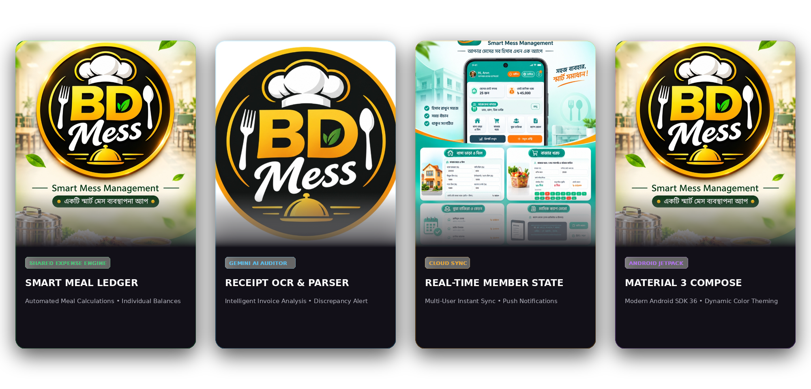

<div align="center">

# 🏠 BD MESS — Smart Mess Living & Shared Expense Manager
### AI-Powered Bachelor Mess Accounting Android App Engineered with Kotlin & Jetpack Compose

[](https://bd-mess.pages.dev/)
[](https://ai.studio/apps/69fabc28-c6de-4d99-9f95-80e2caa2dfaa)
[](https://kotlinlang.org/)
[](https://developer.android.com/jetpack/compose)
[](https://ai.google.dev/)
[](https://bd-mess.pages.dev/)
[](LICENSE)

<br/>

**[⚡ View Live Web App](https://bd-mess.pages.dev/)** &nbsp;•&nbsp; **[📦 GitHub Repository](https://github.com/labibfohayer/BD-Mess-App)**

<br/>



</div>

---

## 📌 Architectural Overview

**BD Mess** is an intelligent Android application engineered for university students, professionals, and bachelor apartment residents across Bangladesh. Replacing error-prone paper ledgers, BD Mess automates shared apartment accounting—from multi-meal logs and dynamic meal-rate calculations to fixed utility splits and AI-assisted receipt audits.

Engineered with **Kotlin**, **Jetpack Compose (Material 3)**, and Android SDK 36, the platform integrates **Google Gemini API** to analyze grocery receipts, detect calculation discrepancies, and generate transparent monthly financial balance sheets.

---

## ⚡ Key Engineering Highlights

```
+-------------------------------------------------------------+
|                     BD MESS CALCULATION CORE                |
|                                                             |
|   Daily Meals + Bazar Total  ==>  [Dynamic Meal Rate Engine]│
|   Formula: Rate = Sum(Bazar) / Sum(Cumulative Meals)       |
|                                                             |
|   Fixed Utility Splitter     ==>  [Individual Balance Sheet]│
|   Gemini Receipt Parser      ==>  [Automated Audit Report]  |
+-------------------------------------------------------------+
```

1. **Automated Dynamic Meal Rate Engine:**
   - Real-time meal calculation formula tracking individual balances with sub-unit precision.
   - Separate accounting for grocery deposits (Bazar) and individual consumption records.

2. **Gemini AI Receipt Auditor:**
   - Multimodal OCR receipt parser extracting itemized grocery lists and validating merchant totals.
   - Proactive discrepancy alerts identifying unrecorded expenses or duplicate entries.

3. **Modern Jetpack Compose UI:**
   - Material 3 dynamic color theming, declarative layout states, and offline-first room database sync.

---

## 🛠️ Tech Stack & Architecture

| Layer | Technologies | Purpose |
| :--- | :--- | :--- |
| **Mobile Core** | Kotlin, Android SDK 36, Jetpack Compose | Native declarative Android UI with Material 3 theming |
| **AI Auditing** | Google Gemini 1.5 API, Generative AI SDK | Multimodal grocery receipt parsing and anomaly detection |
| **Web & PWA** | Cloudflare Pages, HTML5 / JS PWA Companion | Instant web access for non-Android residents |
| **Data Engine** | Room Persistence Library, Coroutines, Flow | Asynchronous offline-first reactive data store |

---

## 🚀 Getting Started & Local Development

```bash
# Clone the repository
git clone https://github.com/labibfohayer/BD-Mess-App.git
cd BD-Mess-App

# Open in Android Studio
# Build APK or run on connected device/emulator
./gradlew assembleDebug
```

---

## 📄 License
This project is open-source and distributed under the [MIT License](LICENSE).
